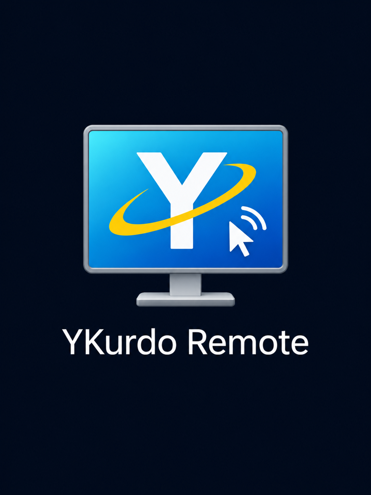

# YKurdo Remote — دانلود / Download



**آخرین نسخهٔ پایدار تجاری ویندوز: 1.2.5 — نسخهٔ شخصی ویندوز: 1.2.0**

| محصول | دانلود نصب‌کننده Windows x64 |
|---|---|
| **Commercial — تجاری** | [دانلود Commercial 1.2.5](https://github.com/sadollahkarami1-droid/YKurdo-Remote-Download/releases/download/v1.2.5-be43db3aa0ae/YKurdo-Remote-Commercial-Setup-x64-1.2.5-be43db3aa0ae.exe) |
| **Personal — شخصی غیرتجاری** | [دانلود Personal 1.2.0](https://github.com/sadollahkarami1-droid/YKurdo-Remote-Download/releases/download/v1.2.0-91b33d881736/YKurdo-Remote-Personal-Setup-x64-1.2.0-91b33d881736.exe) |

[توضیحات آخرین نسخه و SHA-256](https://github.com/sadollahkarami1-droid/YKurdo-Remote-Download/releases/latest)

## Commercial 1.2.5

- انتخاب زبان پیش از نصب: فارسی، انگلیسی، عربی، آلمانی، ایتالیایی، فرانسوی و اسپانیایی؛ ورود و خوشامد به زبان انتخاب‌شده.
- تم شب در نصب تازه؛ حفظ زبان و ظاهر قبلی هنگام ارتقای بی‌صدا.
- راست‌چین فارسی/عربی و چپ‌چین لاتین، جای کلیدها متناسب با زبان، نوشته‌های درشت‌تر و پررنگ‌تر.
- پنجرهٔ بزرگ‌تر سرویس‌های هوش مصنوعی، ماه پرنورتر، نورافشانی اتصال و هشدار قطع اتصال؛ لوگوی جدید برنامه.
- حفظ اصلاح قطع اتصال در پاسخ‌های بزرگ از نسخهٔ 1.2.4.

هر ۳۱ ابزار اصلی در نسخه تجاری پشتیبانی می‌شود. روشن‌کردن Remote ابزارها و Full Auto را آماده و مجوز اجرای فرمان را خودکار تمدید می‌کند؛ خاموش‌کردن آن موتور محلی و درخواست‌های جاری را متوقف می‌کند. پس از بازشدن دوبارهٔ برنامه، اتصال و دسترسی باید با کلید اصلی توسط کاربر فعال شود. می‌توان مجوز ابزارها و پوشه‌های مجاز را در برنامه مدیریت کرد.

حساب تأییدشده و کنترل‌های سرور برقرارند. مالک اصلی با نقش سروری Owner دسترسی دائمی دارد؛ مشتریان به اشتراک معتبر یا trial فعال نیاز دارند. نصب‌کننده‌ها و تنظیمات Personal و Commercial مستقل‌اند.

## نصب و اتصال

1. محصول مناسب را دانلود و نصب کنید؛ در نصب تعاملی زبان را پیش از نصب انتخاب کنید.
2. در نسخه تجاری وارد حساب شوید، دستگاه و پوشه‌های مجاز را تنظیم کنید و Remote را روشن کنید.
3. کانکتور MCP را در کلاینت پشتیبانی‌شده با `https://ykurdo-api.sdigital.app/mcp` متصل و احراز هویت را تکمیل کنید. پس از ارتقا فهرست ابزارها را تازه کنید.

## Linux — آزمایشی 1.3.0-beta.1

دو بسته مستقل برای Ubuntu 24.04 x64؛ رابط محلی در مرورگر و Node/ripgrep همراه بسته.

| محصول Linux | بسته Ubuntu / Debian |
|---|---|
| Personal | [دانلود شخصی .deb](https://github.com/sadollahkarami1-droid/YKurdo-Remote-Download/releases/download/linux-v1.3.0-beta.1-1f144b0fe2aa/ykurdo-remote-personal_1.3.0.beta.1-1f144b0fe2aa_amd64.deb) |
| Commercial | [دانلود تجاری .deb](https://github.com/sadollahkarami1-droid/YKurdo-Remote-Download/releases/download/linux-v1.3.0-beta.1-1f144b0fe2aa/ykurdo-remote-commercial_1.3.0.beta.1-1f144b0fe2aa_amd64.deb) |

[همهٔ فایل‌های Linux و SHA-256](https://github.com/sadollahkarami1-droid/YKurdo-Remote-Download/releases/tag/linux-v1.3.0-beta.1-1f144b0fe2aa) · [راهنمای نصب و محدودیت‌ها](LINUX-INSTALL-FA.md)

آزمون Linux روی Ubuntu در WSL2 انجام شده است؛ ورود Google واقعی و اجرای طولانی روی دسکتاپ‌های مختلف هنوز تأیید نشده‌اند. ساخت PDF به Chrome/Chromium نیاز دارد. نسخه Linux آزمایشی است؛ انتشار Windows و Linux مستقل است.

## بررسی فایل

نصب‌کننده‌ها فعلاً امضای Authenticode ندارند. SHA-256 را با فایل checksum همان انتشار مقایسه کنید:

```powershell
Get-FileHash .\YKurdo-Remote-*-Setup-x64-*.exe -Algorithm SHA256
```

## English

Latest stable **Windows Commercial 1.2.5**, **Windows Personal 1.2.0**; Linux 1.3.0-beta.1 remains a separate preview. Setup offers seven languages. Welcome follows the app language; fresh installs default to Night. Improved RTL/LTR text and switch placement, larger typography and AI-services panel, brighter moon and new owner-provided logo. The large-response crash fix is retained.

All 31 tools are supported in Commercial. Remote On prepares Full Auto and renews the execution lease; Off stops the local engine and in-flight work. Restart requires explicit local activation. Approved folders, tool permissions, authentication and subscription/trial requirements remain enforced. Owner access is granted by a server role. Personal and Commercial keep independent installations and settings.

Installers are currently not Authenticode-signed; verify the release SHA-256. Superseded Windows Commercial downloads are removed after the new release is verified. Current Personal and Linux downloads remain available. This repository distributes public binaries and documentation; development sources remain private.
