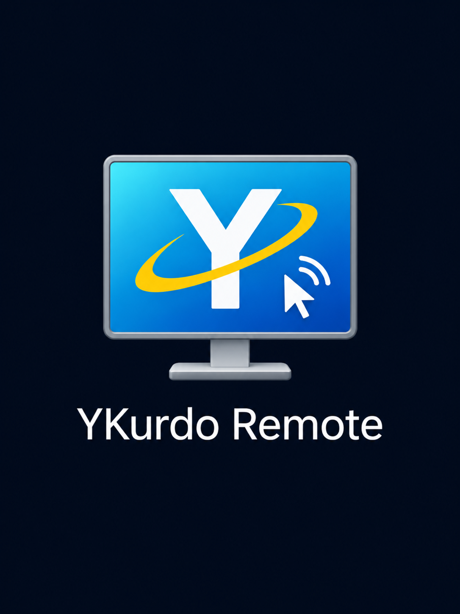

# YKurdo Remote — دانلود / Download



**آخرین نسخه‌ها: Windows Commercial 1.3.13 · Linux 1.3.13 · Android 0.3.0 · Windows Personal 1.2.0**

| محصول | دانلود |
|---|---|
| **Windows — Commercial (تجاری)** | [دانلود 1.3.13 (.exe)](https://github.com/sadollahkarami1-droid/YKurdo-Remote-Download/releases/download/v1.3.13-ef2e9054b4c7/YKurdo-Remote-Commercial-Setup-x64-1.3.13-ef2e9054b4c7.exe) |
| **Windows — Personal (شخصی)** | [دانلود 1.2.0 (.exe)](https://github.com/sadollahkarami1-droid/YKurdo-Remote-Download/releases/download/v1.2.0-91b33d881736/YKurdo-Remote-Personal-Setup-x64-1.2.0-91b33d881736.exe) |
| **Linux — Commercial** | [دانلود 1.3.13 (.deb)](https://github.com/sadollahkarami1-droid/YKurdo-Remote-Download/releases/download/linux-v1.3.13-f60cee283f0f/ykurdo-remote-commercial_1.3.13-f60cee283f0f_amd64.deb) |
| **Linux — Personal** | [دانلود 1.3.13 (.deb)](https://github.com/sadollahkarami1-droid/YKurdo-Remote-Download/releases/download/linux-v1.3.13-f60cee283f0f/ykurdo-remote-personal_1.3.13-f60cee283f0f_amd64.deb) |
| **Android** | [دانلود 0.3.0 (.apk)](https://github.com/sadollahkarami1-droid/YKurdo-Remote-Download/releases/download/android-v0.3.0/YKurdo-Remote-Android-0.3.0.apk) |

[توضیحات و SHA-256 همهٔ نسخه‌ها](https://github.com/sadollahkarami1-droid/YKurdo-Remote-Download/releases)

## Windows Commercial 1.3.13

- ساخت حساب، تأیید ایمیل و ورود روی نصب تازه درست شد (نسخهٔ Microsoft Store هم همین اصلاح را دارد).
- ویجت ساعت دیجیتال با تاریخ شمسی و شمارندهٔ زندهٔ کردیت (امروز، این ماه، کل).
- بخش اسکیل‌ها: ۶۹۰ اسکیل در ۱۲ دسته با کلیدهای سبز؛ یک کلید برای دسترسی ChatGPT / Claude / Gemini.
- پنل اتصال Gemini (Antigravity و Gemini CLI)؛ کاشی واحد «حساب و صورتحساب».
- SHA-256: `8C3D1B48AEEC52D00211049285E86A4D797BB4656549D7EB165882E604A53DF4`

## Linux 1.3.13

دو بستهٔ مستقل Personal و Commercial برای Ubuntu 24.04 / Debian x64؛ رابط محلی در مرورگر و Node/ripgrep همراه بسته. نصب: `sudo apt install ./ykurdo-remote-commercial_1.3.13-f60cee283f0f_amd64.deb` سپس `ykurdo-commercial ui --open`. [راهنمای نصب](LINUX-INSTALL-FA.md)

## Android 0.3.0

بخش اسکیل‌ها و اتصال یک‌لمسی به ChatGPT / Claude / Gemini. **امضای برنامه عوض شده است:** اگر 0.2.2 نصب است، یک بار آن را حذف و 0.3.0 را نصب کنید.

## نصب و اتصال

1. محصول مناسب را دانلود و نصب کنید؛ در نصب تعاملی زبان را پیش از نصب انتخاب کنید.
2. در نسخه تجاری وارد حساب شوید، دستگاه و پوشه‌های مجاز را تنظیم کنید و Remote را روشن کنید.
3. کانکتور MCP را در Claude، ChatGPT یا Gemini با `https://ykurdo-api.sdigital.app/mcp` متصل و احراز هویت را تکمیل کنید. پس از ارتقا فهرست ابزارها را تازه کنید.

## بررسی فایل

نصب‌کننده‌ها فعلاً امضای Authenticode ندارند. SHA-256 را با فایل checksum همان انتشار مقایسه کنید:

```powershell
Get-FileHash .\YKurdo-Remote-*-Setup-x64-*.exe -Algorithm SHA256
```

## English

Latest: **Windows Commercial 1.3.13**, **Linux 1.3.13** (Personal and Commercial .deb/.tar.gz), **Android 0.3.0**, **Windows Personal 1.2.0**.

Commercial 1.3.13 fixes account sign-up, email verification and sign-in on a fresh install, and adds a live credit meter with a digital clock, a 690-skill library with per-area switches, and a Gemini (Antigravity / Gemini CLI) connection panel. Android 0.3.0 adds the Skills section and is signed with a new key: uninstall 0.2.2 once before installing.

Connect Claude, ChatGPT or Gemini to `https://ykurdo-api.sdigital.app/mcp`. Installers are currently not Authenticode-signed; verify the release SHA-256. This repository distributes public binaries and documentation; development sources remain private.
